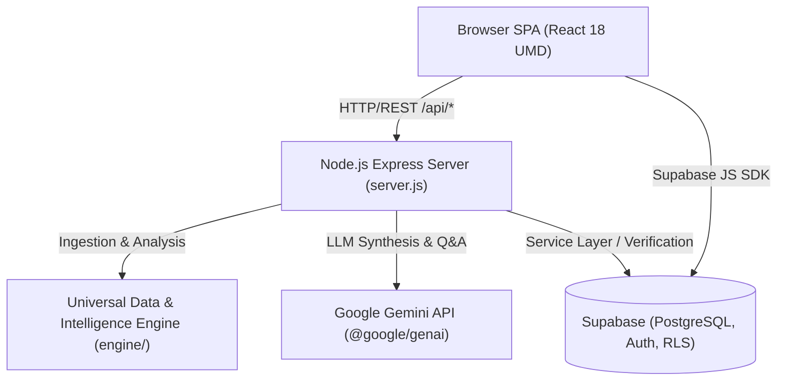

# InsightIQ AI — System Architecture

## 1. Overview
InsightIQ AI is an enterprise-grade autonomous intelligence platform providing end-to-end data ingestion, profiling, deterministic mathematical machine learning, chronological forecasting, and multi-tenant role-based workspace management.



## 2. Directory Structure

```
Project/
├── app.js                 # Primary frontend analytical application logic & UI
├── index.html             # Single Page Application entrypoint (React 18 UMD)
├── server.js              # Production Express.js server & REST API
├── server.ps1             # Windows PowerShell server runner
├── package.json           # Node.js dependencies and test commands
├── tsconfig.json          # TypeScript definitions
│
├── assets/                # Production static assets (icons, illustrations)
├── components/            # UI components and layouts
├── data/                  # Approved sample datasets and fixtures
│   ├── sample_customer_telemetry.csv
│   └── sample_financial_forecast.csv
├── docs/                  # Architecture, testing, and deployment documentation
│   ├── ARCHITECTURE.md
│   ├── DEPLOYMENT.md
│   └── TESTING.md
├── engine/                # Universal Data & Intelligence Engine
│   ├── analysis/          # Statistics, PCA, K-Means++, Forecasting, Anomaly
│   ├── cleaning/          # Non-destructive data cleaning & quarantine
│   ├── ingestion/         # Delimited, Excel, JSON, PDF, and DOCX adapters
│   ├── intelligence/      # Unified Catalog & Cross-source Intelligence
│   ├── profiling/         # Tabular & document profilers
│   └── understanding/     # AI synthesis, PII redaction, prompt sanitization
├── pages/                 # Specialized views (e.g. auth)
├── scripts/               # Maintenance and development tooling
│   ├── db/                # Database inspection and schema probing
│   ├── dev/               # Development-time debugging and patch scripts
│   └── maintenance/       # Cleanup and audit utilities
├── src/                   # TypeScript interfaces, services, and shared types
├── styles/                # Modular CSS design system (tokens, layout, admin)
├── supabase/              # Schema definitions and database migrations
├── tests/                 # Automated test harness categorized by domain
│   ├── auth/              # Authentication and security regression suites
│   ├── engine/            # Data processing, ML, statistics, and readiness
│   ├── roles/             # RBAC, Admin Portal, and role synchronization
│   ├── ui/                # UI modal centering, clean workspace, and fallback
│   └── verification/      # E2E headless browser visual verification
├── theme/                 # Design tokens and runtime bridge
└── verification/          # Retained visual screenshots and test artifacts
    ├── multiselect/
    └── screenshots/
```

## 3. Frontend Architecture
- **Runtime:** React 18 production UMD loaded directly in `index.html`.
- **Zero-Bundler Simplicity:** Requires no Webpack, Vite, or Babel build step; code executes immediately.
- **Client Libraries:** SheetJS (XLSX) for tabular ingestion, jsPDF + AutoTable for real vector PDF generation.
- **Design System:** Obsidian dark palette (`theme/tokens.js`, `theme/tokens.bridge.js`, `styles/`).

## 4. Backend & Security Boundaries
- **Server:** Node.js Express (`server.js`) with dynamic port binding fallback.
- **Security Middleware:** Blocks public access to server internals (`.env`, `.git`, `server.js`, `engine/`, `tests/`, `scripts/`, `supabase/`, `node_modules/`).
- **Rate Limiting:** Sliding-window rate limiter protecting `/api` and AI copilot endpoints.
- **RBAC:** Four core personas (Data Analyst, Data Scientist, Business Analyst, Admin). Admin endpoints (`/api/admin/*`) require server-verified admin tokens.
